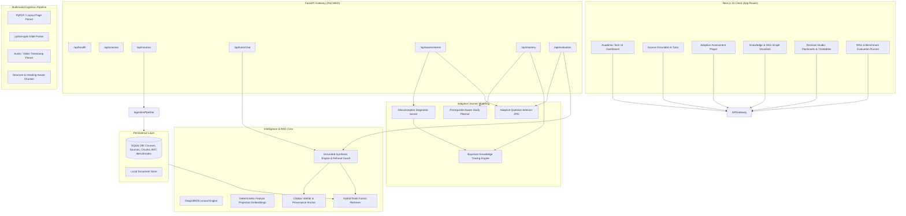

# EduNexus AI - System Architecture

EduNexus AI is an enterprise-grade, competition-quality AI learning platform built for the **Multimodal AI Hackathon 2026 Track D challenge**. It unifies textbooks, lecture slides, notes, and video/audio into a verifiable, source-grounded learning knowledge base.

---

## 1. High-Level Architecture Diagram

---

## 2. Core Architectural Pillars

### A. Strict Grounding and Non-Hallucination
- Every assertion made by EduNexus AI is bound to a verified `chunk_id`.
- The system includes a dual-threshold sufficiency checker:
  1. Lexical content presence: Verifies that core content tokens exist in the retrieved document.
  2. Relevance confidence: If score is below threshold or query is out-of-scope, the platform explicitly refuses with an ungrounded warning rather than hallucinating facts.

### B. Multimodal Provenance Preservation
- **PDF Documents**: Exact 1-indexed page numbers are extracted and attached to every chunk.
- **PowerPoint Decks**: Exact slide numbers, speaker notes, and slide titles are stored.
- **Audio / Video**: Start and end timestamps are preserved for seeking.

### C. Bayesian Knowledge Tracing (BKT)
- Models student mastery as a latent variable $P(L_t)$ updated through exact Bayes rule:
  $$\text{Posterior } P(L_t | \text{Obs}) = \begin{cases} \frac{P(L_t)(1 - P(S))}{P(L_t)(1 - P(S)) + (1 - P(L_t))P(G)} & \text{if Correct} \\ \frac{P(L_t)P(S)}{P(L_t)P(S) + (1 - P(L_t))(1 - P(G))} & \text{if Incorrect} \end{cases}$$
- Advances learning transition: $P(L_{t+1}) = \text{Posterior} + (1 - \text{Posterior}) \cdot P(T)$.

### D. Zero Paid Services Mandatory
- Operates out-of-the-box in local demo mode with deterministic embeddings, BM25, and local grounded synthesis.
- Pluggable Google Gemini (`gemini-1.5-flash`, `text-embedding-004`) support via simple configuration in `.env`.
